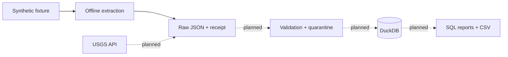

# Earthquake Data Pipeline

[](https://github.com/ManeeGit/earthquake-data-pipeline/actions/workflows/tests.yml)

**A local data engineering project, built one understandable milestone at a time.**

Capture earthquake-shaped JSON, preserve its provenance, and learn how to turn
source records into trustworthy SQL reports. Designed for Python on a Mac with
Apple Silicon and 8 GB RAM, using DuckDB, SQL and pytest.

> **Current status: milestone 1 of 5.** Offline extraction is implemented and tested.
> All bundled events are synthetic. Transformation, database loading, live USGS
> requests and analytical reports are planned, not implemented.

[Getting started](#getting-started) · [Architecture](docs/architecture.md) ·
[First lesson](docs/milestone-01.md) · [Data dictionary](docs/data_dictionary.md) ·
[Learning journal](LEARNING_JOURNAL.md)

## What works today

- Capture a clearly labeled, two-event synthetic GeoJSON fixture entirely offline.
- Preserve the original JSON bytes, including whitespace.
- Record the source URL, retrieval time, declared UTC window, count and SHA-256.
- Keep a separate capture directory on every run.
- Log feature count, byte count and extraction duration.
- Test parsing, null magnitude, empty input, malformed containers and reruns.

The pipeline runs as a command and exits. It needs no Docker, API keys, cloud
runtime, paid service or database server. GitHub hosts the source; the demo runs
locally after dependency installation.

## Getting started

Verified environment: **Python 3.14.6 · DuckDB 1.4.3 · pytest 9.0.2 · macOS ARM64**.
Use Python 3.14.6 for the documented environment. `.python-version` records that
version; it does not install an interpreter.

```sh
git clone https://github.com/ManeeGit/earthquake-data-pipeline.git
cd earthquake-data-pipeline

python3 --version
python3 -m venv .venv
.venv/bin/python -m pip install --only-binary=:all: --timeout 20 --retries 2 -r requirements.txt
.venv/bin/python -m pip check

.venv/bin/python -m earthquake_pipeline offline
.venv/bin/python -m pytest -q
```

If you already have this project locally, start from its directory and skip the
clone commands. All six project packages have exact pins in
[requirements.txt](requirements.txt). Installation requires internet access;
the demo and tests do not. Using `.venv/bin/python` explicitly selects the project
environment, so activation is optional.

Compatibility was checked against the [Python venv documentation](https://docs.python.org/3.14/library/venv.html),
[DuckDB Python documentation](https://duckdb.org/docs/1.4/clients/python/overview),
[DuckDB 1.4.3 release files](https://pypi.org/project/duckdb/1.4.3/), and
[pytest 9.0.2 release metadata](https://pypi.org/project/pytest/9.0.2/).
DuckDB provides a CPython 3.14 macOS ARM64 wheel. The selected versions were
installed and tested; they are not a claim to be the newest releases.

## A real run with synthetic input

The first local run produced the following output:

```text
INFO stage=extract source=synthetic_fixture rows=2 bytes=864 elapsed_seconds=0.029693
SYNTHETIC DEMO — invented events; no USGS request made
Captured features: 2
Requested UTC start: 2024-01-01T00:00:00+00:00
Requested UTC end (exclusive): 2024-01-02T00:00:00+00:00
Raw JSON: data/raw/offline/20261104T203437589912Z_3ab7fab5/response.json
Receipt: data/raw/offline/20261104T203437589912Z_3ab7fab5/metadata.json
```

Capture names and timing change each run. The first test run returned
`15 passed in 0.03s`. These are actual execution results using invented data.

| Output | Purpose |
| --- | --- |
| `response.json` | Exact source bytes, available for replay and inspection |
| `metadata.json` | Retrieval receipt, kept separate from the original JSON |
| Terminal log | Feature count, byte count and elapsed time |

The receipt's source is a local `file:` URL and `http_request_sent` is false.
Its UTC window comes from the fixture's declared day; no event-time filtering
happens yet. The captured count uses the actual `features` list. Generated
captures stay local and are ignored by Git.

## How the project grows



| Milestone | Status | What it demonstrates |
| --- | --- | --- |
| 1. Offline capture | Complete | Isolation, provenance, exact raw preservation, offline tests |
| 2. Clean and validate | Next | Flattening, UTC conversion, missing values, quarantine with reasons |
| 3. Load DuckDB | Planned | One row per event ID, idempotent reruns, newer-revision updates |
| 4. Live extraction | Planned | One UTC day, bounded requests, timeouts, retries, truncation detection |
| 5. SQL reports | Planned | Counts, magnitude summaries, ten largest events, terminal and CSV output |

Each milestone includes an explanation, working code, actual input/output,
one exercise and two questions before the next milestone begins.

## Explore the repository

```text
earthquake_pipeline/       Extraction and command-line entry point
fixtures/                 Clearly labeled synthetic source data
tests/                    Offline pytest suite
docs/                     Architecture, data dictionary and first lesson
.github/workflows/        Optional GitHub verification
LEARNING_JOURNAL.md        Decisions, evidence and learning checkpoints
requirements.txt          Exact dependency versions
```

Start with the [first lesson](docs/milestone-01.md) for the code walkthrough and
exercise. Read the [data dictionary](docs/data_dictionary.md) for timestamp units,
coordinate ordering and missing-value rules. The [journal](LEARNING_JOURNAL.md)
records results and environment findings, including a local HTTPS certificate
issue to resolve before live mode.

## Verification and contributions

The [GitHub workflow](.github/workflows/tests.yml) runs the existing tests and
offline demo on pushes and pull requests in **public repositories only**. It uses
a standard Ubuntu runner, pinned action commits and read-only permissions, with
no artifact uploads or dependency cache. Private repositories skip the job;
local tests remain available. Standard public-repository runners are free under
[GitHub's documented billing rules](https://docs.github.com/en/billing/concepts/product-billing/github-actions).

See [CONTRIBUTING.md](CONTRIBUTING.md) for local checks and the milestone workflow,
and [CHANGELOG.md](CHANGELOG.md) for the implemented scope.

## Planned command interface

These commands are design notes and **do not work yet**:

```text
.venv/bin/python -m earthquake_pipeline live --day 2024-01-01
.venv/bin/python -m earthquake_pipeline report --mode offline
.venv/bin/python -m earthquake_pipeline report --mode live
```

Offline and live databases will be separate so synthetic events cannot enter
live reports. Keeping raw capture history is distinct from deduplicating events
in the database.

## Data source and license

The fixture follows the [USGS GeoJSON structure](https://earthquake.usgs.gov/earthquakes/feed/v1.0/geojson.php).
Live extraction will use the [USGS Earthquake Catalog API](https://earthquake.usgs.gov/fdsnws/event/1/).
This learning project is not affiliated with USGS.

Project code and documentation are provided under the [MIT License](LICENSE).
