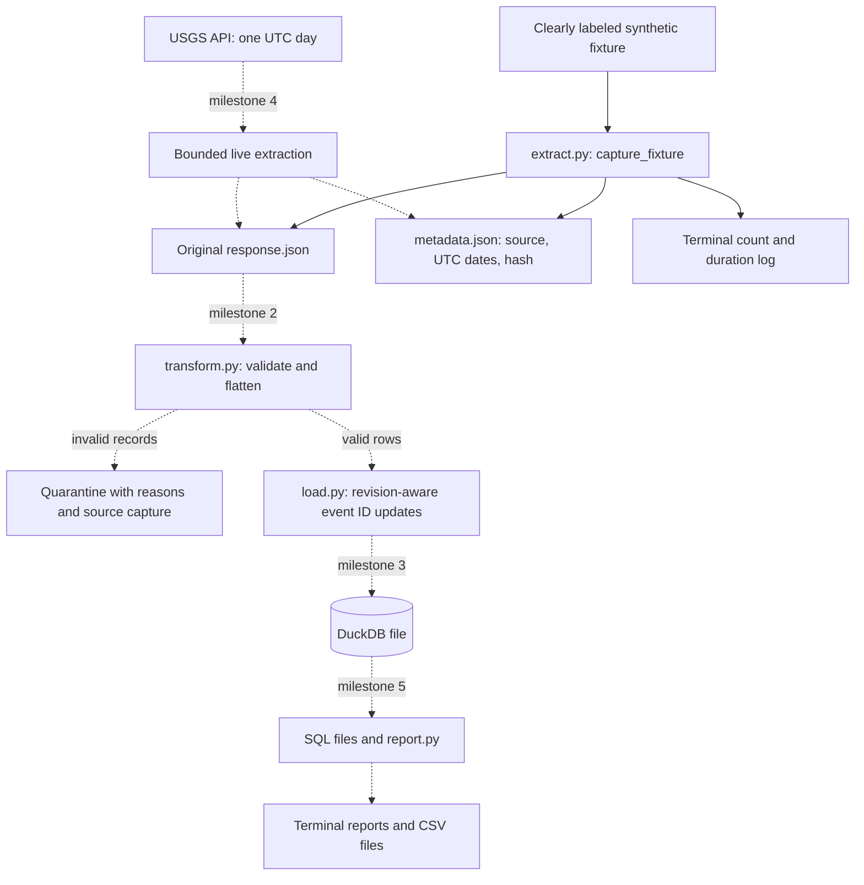

# Architecture

Solid arrows show the implemented milestone. Dotted arrows show planned work.

Extraction obtains data; transformation decides how to interpret it; loading
changes database state; reporting reads that state. Keeping these stages separate
lets us test and rerun each one independently. Only `extract.py` exists today.

Data flow in milestone 1 is entirely local. The fixture and resulting captures
are small; each command finishes and exits. Later, DuckDB will use a conservative
memory limit and thread count suitable for an 8 GB machine. Offline/live captures
and databases will remain separate. No background service or scheduler is planned.
